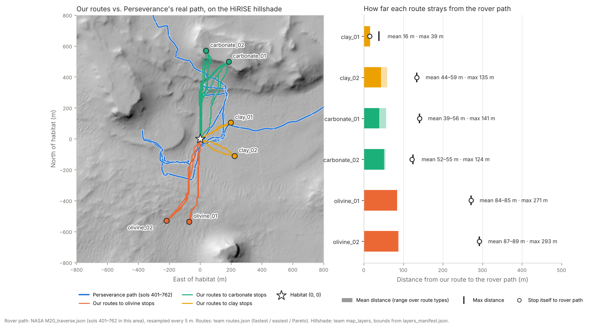

# Jezero Marswalk — Euler's Disappointments

**Google Maps tells you how to get there. We also tell you whether you can make it back.**

NASA Space Apps Challenge 2026 · Team **Euler's Disappointments** · Challenge: a layered map to plan a Marswalk.

Jezero Marswalk plans walks for an astronaut on foot in Jezero crater, Mars. It turns NASA orbital and rover data into decisions:

- **"I want to go to this mineral."** Pick probable carbonate, olivine or clay and get every route there and back, each with distance, time and effort.
- **"I have this much time."** Get the stops that fit in 1 to 8 hours, and the order to visit them.
- **Emergency.** Lost comms or a broken part? See which shelters, communication points or the habitat you can still reach with the suit supply you have left, keeping a reserve.
- **Stop photos.** Real Perseverance photos at each stop, with the mineral and the MEDA pressure measured there.

**See it: https://marseva.us** — a front end built on Base44 to look around the crater and compare the routes. It reads the precomputed files in `base44_handoff/`, so it is a way to visualise what the engine produced rather than the full system described below.

---

## What the engine computes

| | |
|---|---|
| Site | Jezero crater; habitat at 18.452739° N, 77.405768° E (flat ground, 1.4° slope) |
| Terrain model | 5 m grid built from the 1 m HiRISE DTM, THEMIS thermal inertia and the CRISM mineral map |
| Science stops | 6 probable mineral sites (2 olivine, 2 carbonate, 2 clay/kaolinite), all within 574 m of the habitat and near Perseverance's real path |
| Routes | 28 precomputed routes: fastest, easiest and Pareto alternatives to every stop (always round trip), 5 time-budget tours, 6 routes that pass by a shelter |
| Safety | No point of any route is more than **7.5 min** from the habitat or a terrain shelter |
| Full tour | All 6 stops: **2.74 km, 3 h 57 min** (57 min walking + 6 × 30 min of science), within the 6 h recommended EVA |

| Destination (round trip) | Distance | Total time (incl. 30 min science) | Steepest walking grade | Steepest ground under the route |
|---|---|---|---|---|
| Clay stops | 489–540 m | 38–39 min | 2.0–2.8° | 2.6–3.5° |
| Olivine stops | 1127–1257 m | 50–52 min | 7.2–8.6° | 10.0–12.1° |
| Carbonate stops | 1163–1242 m | 58–60 min | 21.8–28.0° | 33.4–39.5° |

The carbonates sit on top of an escarpment: their routes cross 34–40° ground diagonally, so the walking grade stays at 28° or less. Anything above 20° is reported as a **warning** (team decision), never silently hidden.

## Method

1. **Common grid.** All layers are resampled to the same 5 m grid in the DTM's equirectangular projection (Mars 2000 sphere, R = 3,396,190 m). Ground east distance is corrected by cos(latitude) (×0.948 at Jezero). Roughness is the standard deviation of the 1 m slope inside each 5 m cell, so boulder fields are not averaged away.
2. **Graph.** Each cell is a node connected to its 8 neighbours. Edges are directed, because uphill costs more than downhill. Forbidden cells (no edge) are cells without elevation, thermal inertia below 100 (possibly not load-bearing; none in this area) and a DTM artefact strip west of lon 77.35° E (our assumption; far from the area).
3. **Time.** Tobler's hiking function, scaled so that flat ground gives 3.6 km/h, the Apollo planners' walk-back speed.
4. **Effort.** Pandolf's metabolic equation (no load), with a terrain factor from roughness and soft soil (thermal inertia). Downhill counts as flat. Effort is expressed in **hours of suit supply at 1200 BTU/h**: a model estimate, **not verified for Mars**.
5. **Search.** Dijkstra's algorithm (scipy.sparse.csgraph) on about 2.5 million edges. The fastest route minimises time, the easiest minimises effort, and blended weights give the non-dominated alternatives (Pareto front). Multi-stop order is an exhaustive search. Emergency mode is one Dijkstra from the astronaut's position, filtered by the usable suit supply (25% reserve, team assumption).
6. **Shelters and comms.** Shelters are walkable cells (≤ 20°) where the terrain hides the most sky, using horizon angles over 500 m in 16 directions: a geometric proxy, not a life-support shelter. A communication point is a walkable cell with a straight line of sight to a 3 m antenna at the habitat, with the suit antenna at 1.8 m (assumed heights).

All constants live in [`routing/config.py`](routing/config.py), each labelled **SOURCED** (with its reference) or **ASSUMPTION**.

## Validation against Perseverance's real path

We compared our routes with NASA's `M20_traverse.json` (Perseverance's actual drives, sols 401–762 in this area).



- Between 77% and 100% of each route to the clay and carbonate stops stays within 100 m of the rover's path. The route to clay 1 runs on top of it (16 m on average).
- In 5 of the 6 stops, the largest separation is at the stop itself, which the rover never drove to.
- The olivine stops are 271–293 m from the rover's path; the rover never entered that olivine patch.
- The habitat is 22 m from the rover's path.

The rover chooses its path for science and wheel safety, not for human effort, so this checks that we use the same corridors, not that our routes are "correct". Full table: [`docs/validation/route_vs_rover.csv`](docs/validation/route_vs_rover.csv).

## Why this scales

Nothing in the engine knows it is looking at Jezero. It reads a raster, builds a
graph of cells, and runs Dijkstra. Every property below was checked against the
code in this repository, not assumed.

**More resolution is a flag, not a rewrite.** Cell size is `build_grid.py --res`.
We ran 5 m; the default is 10 m and the source DTM is 1 m. The same command
builds any of them, and nothing downstream is told which one it got: the planner
reads the cell size out of `grid.json`.

**More area costs close to linear time.** The grid we build already spans
4,280 x 4,297 cells, 21.4 x 21.5 km, about 18.4 million cells of the whole
crater. The routing window used for the submitted routes is a crop of that, not
the engine's ceiling. Dijkstra over an 8-connected grid has about eight edges
per cell, so the work grows with the number of cells rather than exploding with
the size of the map, and scipy's implementation returns the exact optimum, never
an approximation that degrades as the map grows.

**Another site is another file.** `build_grid.py` reads the projection, the
origin and the pixel size out of the DTM itself; nothing about the coordinate
system is written into the code. Point it at a DTM of Gale, of the lunar south
pole, of anywhere with elevation data, give it a base latitude and longitude,
and the same pipeline produces the same outputs. Layers that are missing simply
drop out of the cost model instead of breaking it.

**Better numbers are a config edit.** `routing/config.py` carries 10 constants
marked SOURCED and 10 marked ASSUMPTION, each with its reference or its reason.
When a real Mars EVA duration, a measured walking speed or a true suit
consumption rate is published, it replaces one labelled line. No equation in the
planner changes, and the tests immediately show what moved.

**More data makes the answers better, not just bigger.** The route alternatives
come from blending the cost weights and keeping the non-dominated results, so
every new layer adds a dimension the astronaut can trade against the others.
Today the blend runs over time, effort, terrain and shelter proximity. Add dust
opacity, surface temperature at the hour of the walk, or a measured soil
bearing-strength map, and the same Pareto step yields richer alternatives
without a line of new search code. The validation improves the same way: every
additional sol of rover traverse is more ground truth to check the routes
against.

**Any point, not six.** The saved files hold 28 precomputed routes because the
front end reads files. The API in `api/` computes a route to an arbitrary
coordinate on demand, and it is already tested that way. That is a deployment
step, not new mathematics.

**The loop that closes it: measured walks.** Every number this engine produces
rests on a model that has never been walked. Tobler's curve is from terrestrial
hikers, Pandolf's equation from loaded soldiers on Earth, the 1200 BTU/h rate
from EVA planning; `routing/config.py` labels 10 of its 20 constants ASSUMPTION
for exactly this reason. The app already keeps a trip log: the astronaut saves a
route they chose and it stays on their record. **Today that log lives only in the
browser and is not read back.** The step it exists for is to record what actually
happened next to what was predicted -- the time the walk really took, the supply
really used, where the ground was softer or firmer than the thermal inertia
suggested -- so that each ASSUMPTION constant can be replaced by a measurement
from the surface it was guessed for, and the residual between predicted and
observed becomes a training signal rather than a footnote. That is the point at
which a terrain cost model stops being a planning aid and starts being
calibrated. The architecture is already shaped for it: the model is isolated in
one labelled config file, the engine reads it, and the tests pin every route to
the engine, so a corrected constant propagates everywhere and any drift shows up
immediately. What is missing is the recording of the actual walk, not the way
the model would consume it.

**Where it does not scale yet, and the fix.** Multi-stop ordering is an
exhaustive search over subsets and permutations (`itertools.permutations` in
`routing/planner.py`). It is exact and it is fine for the 6 stops here, but it
is factorial: somewhere past roughly ten stops it becomes the bottleneck, long
before the terrain grid does. The replacement is standard -- dynamic programming
over subsets, which is exponential in stops instead of factorial and handles
tens of stops comfortably. Everything else in the pipeline is already
independent of how many stops there are.

## What we do not know (and say so)

- Minerals are **probable** orbital detections (CRISM), not confirmed samples.
- Oxygen use is a **model estimate** (`oxygen_verified: false` everywhere).
- Slope, duration and radius limits (20°, 6/8 h, 2 km) are NASA **Artemis** planning references; no official Mars values exist.
- Radiation is a **reference** value measured by Curiosity RAD in **Gale crater**, not in Jezero (median 130 µGy/day over the last 30 days of data).
- MEDA has **no published wind** data after sol 315, so we show pressure only.
- Stop photos come from the nearest rover position, 48–294 m away; the camera direction is not confirmed.

## Radiation estimate

Each route carries `radiation_dose_estimate_uGy`, and each shelter a dose rate and its saving against open sky (18–21%). The estimate is walking time × the Curiosity RAD median rate (5.42 µGy/h) × (1 − fraction of sky hidden by terrain). For example, the full 6-stop tour is about 4.8 µGy while walking. This is a **comparison tool, not a dose prediction**: the rate was measured in Gale crater, and terrain shielding is approximated geometrically (see `base44_handoff/route_model.json` → `radiation`).

## Routing API (status: built and tested locally, not deployed yet)

A FastAPI service wraps the same routing engine. It is **not connected to the live app**: marseva.us reads the saved files in `base44_handoff/`, so it can only show the routes that were computed ahead of time. The API is the piece that would let the app ask for a route to any point; it runs and passes its tests, but it is not deployed. Valeria built the first version; Ronald finished it on the current engine. Every number comes from `routing.export_handoff.Exporter`, so the API and the saved files share one source.

- **Endpoints:** `POST /api/routes/fastest`, `/easiest`, `/pareto`, `/mineral-target`, `/time-budget`, `/via-shelter`; `POST /api/emergency/reachable`; `GET /api/health`, `/api/scientific-destinations`, `/api/terrain/layers`, `/api/terrain/point`. A position can be a waypoint id, east/north metres from the habitat, or lat/lon. Docs at `/docs`.
- **Tests:** 49 pass (11 engine tests + 38 API tests), on Python 3.13 and 3.10 (the Dockerfile version). All 28 saved routes and all 4 emergency scenarios come out identical, field by field, from the live API; a test fails if any saved route is left unchecked.
- **Coverage:** the exported map window, about ±1.37 km from the habitat. Unknown or out-of-bounds positions return an error (422), never an estimate.
- **Performance:** about 10 s to start, about 0.3 s per route, about 360 MB of memory.
- **Deploy:** `REGION=<region> bash tools/deploy_cloud_run.sh` deploys to Cloud Run and runs `tools/check_live_api.py` (44 live checks) against the new URL.
- **Not done yet:** Cloud Run deployment and connection to the Base44 app. Until then the app uses the precomputed files in `base44_handoff/`, which stay as the fallback.

## Use of AI tools

The project idea, challenge choice, site, stops and every design decision (cost model, slope warnings instead of bans, what counts as a shelter or a comms point) are the team's. We used an AI assistant (Anthropic's Claude) to help write and debug the Python processing and routing code in this repository, to process and check the data files, and to draft documentation. The routing API (`api/`, `tests/test_api.py`, `tools/`) was written by Ronald with the help of Claude (Anthropic); he directed the work and ran the checks, and the 49 tests compare every answer with the engine-generated files. Valeria's earlier adapter was built with help from OpenAI Codex. Every number in the outputs comes from running this code on the NASA data listed below. Rover photos, positions and the validation were selected and checked by the team.

## What is in this repository

The engine, the data pipeline, the routing API and the outputs they produce. The front end at marseva.us was built on Base44, which does not let us export its source, so it is not here. Everything the front end displays does come from this repository: the JSON files and map layers in `base44_handoff/`.

## Repository layout

| Path | Contents |
|---|---|
| `processing/build_grid.py` | Builds the common grid from the NASA rasters |
| `processing/meda_summary.py` | MEDA pressure summary per sol |
| `routing/` | Terrain, graph, planner and exporters (`export_handoff.py`, `export_grid.py`), plus `config.py` |
| `tests/` | 11 engine tests on synthetic terrain + 38 API tests against the saved outputs |
| `base44_handoff/` | **The output**: JSON files and map layers the app reads (see its `README_sources.md`) |
| `api/` | The routing API (FastAPI: `main.py`, `engine.py`), its contract and example requests; deploy with `Dockerfile` (see `README_API_LIVE.md`) |
| `ronald/` | Stops, rover positions and photo table |
| `docs/` | Photos and MEDA notes, validation figure and table |

## Reproduce

```bash
pip install -r requirements.txt
```

1. **Download the source data** into `data/` (not committed; too large):
   - HiRISE DTM: USGS Mars 2020 TRN HiRISE DTM mosaic, https://doi.org/10.5066/P9REJ9JN (`JEZ_hirise_soc_006_DTM_MOLAtopography_DeltaGeoid_1m_Eqc_latTs0_lon0_blend40.tif`)
   - THEMIS thermal inertia: https://zenodo.org/record/4931348 (`Jezero_Thermal_Inertia_v1.tiff`)
   - CRISM mineral map: https://zenodo.org/record/5575824 (`jezeroFinal.tif` and its legend)
   - Curiosity RAD: `bash scripts/download_rad.sh`
   - MEDA PS files: see `ronald/meda_files.csv`, then `python3 processing/meda_summary.py meda/*.CSV > data/meda_pressure_summary.json`
2. **Build the grid:** `python3 processing/build_grid.py --res 5 --strip 100`
3. **Export everything the app needs (about 10–20 s, about 360 MB RAM).** If you built the grid somewhere other than `data/processed/grid5m`, add `--grid <folder>`. The RAD files must be in `data/rad` (step 1); without them the export still runs but has no radiation fields. Rover positions come from `ronald/rover_waypoints_minerals.csv`.
   ```bash
   python3 -m routing.export_handoff --stops ronald/proposed_stops.csv --photos ronald/photo_table.csv \
       --option A --base-lat 18.452739 --base-lon 77.405768 --out base44_handoff
   ```
4. **Tests:** `python3 -m pytest -q tests` — 49 tests (11 engine, 38 API). They need the grid from step 2,
   because the API loads the real terrain at startup. If your grid is not at `data/processed/grid5m`,
   point to it first: `export MARSWALK_GRID=/path/to/grid5m`.

## NASA data and resources

- USGS Astrogeology — Mars 2020 TRN HiRISE DTM mosaic: https://doi.org/10.5066/P9REJ9JN
- THEMIS-derived thermal inertia of Jezero (Mars Odyssey; Edwards et al.): https://zenodo.org/record/4931348
- CRISM mineral map of Jezero (MRO; Parente, Itoh & Saranathan): https://zenodo.org/record/5575824
- Perseverance waypoints: https://mars.nasa.gov/mmgis-maps/M20/Layers/json/M20_waypoints.json
- Perseverance traverse: https://mars.nasa.gov/mmgis-maps/M20/Layers/json/M20_traverse.json
- Perseverance raw images (Mastcam-Z: NASA/JPL-Caltech/ASU; Navcam: NASA/JPL-Caltech): https://mars.nasa.gov/mars2020/multimedia/raw-images/
- MEDA derived pressure, PDS Atmospheres Node (Rodriguez-Manfredi et al. 2021, https://doi.org/10.17189/1522849): https://atmos.nmsu.edu/PDS/data/PDS4/Mars2020/mars2020_meda/data_derived_env/
- Curiosity RAD Level 2, NASA CDAWeb: https://cdaweb.gsfc.nasa.gov/sp_phys/data/msl/rad/cdf/obs-l2/
- Apollo Lunar Surface Journal (3.6 km/h walk-back speed): https://www.nasa.gov/history/alsj/
- Pandolf equation used for EVA workload, NASA NTRS 20240001423: https://ntrs.nasa.gov/citations/20240001423
- NASA Exploration EVA testing and analogs (Coan 2021; 20° slope, 8 h EVAs), NTRS 20210000827: https://ntrs.nasa.gov/citations/20210000827
- Exploration EVA Concept of Operations, EVA-EXP-0075 (2 km radius)
- Fergason et al. 2012, Space Science Reviews (thermal inertia below 100), doi:10.1007/s11214-012-9891-3
- 1200 BTU/h EVA planning rate: ICES-2026-127

## Team

Euler's Disappointments — Miguel Jazzan · Ronald Aguirre · Marilennis Naranjo · Valeria Calagna · Samantha Miranda · Rania Jazzan
